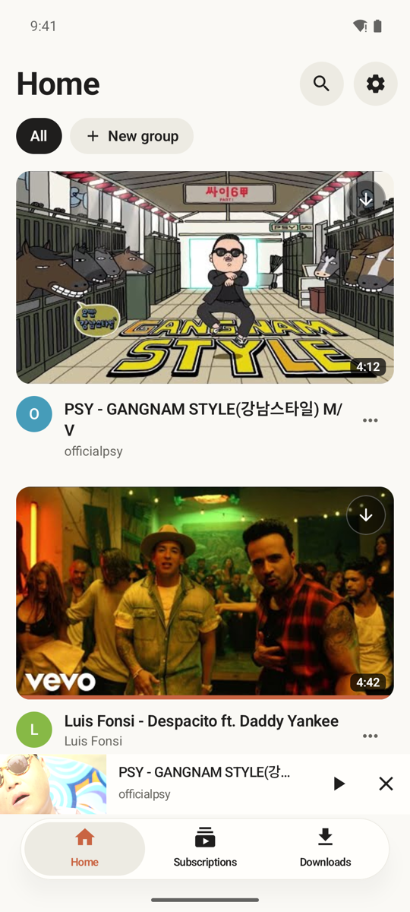
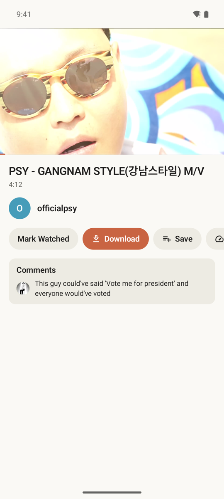
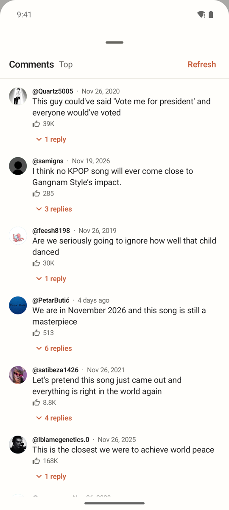
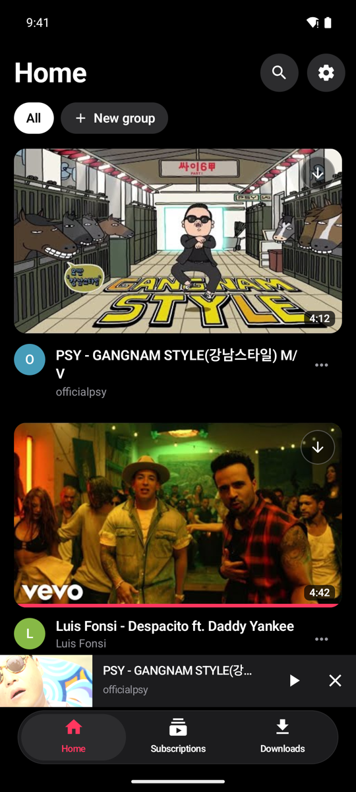
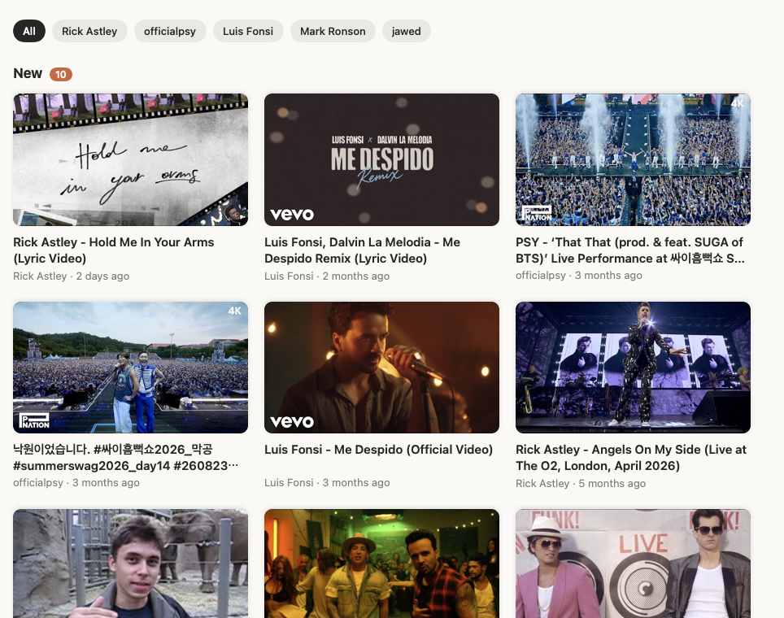
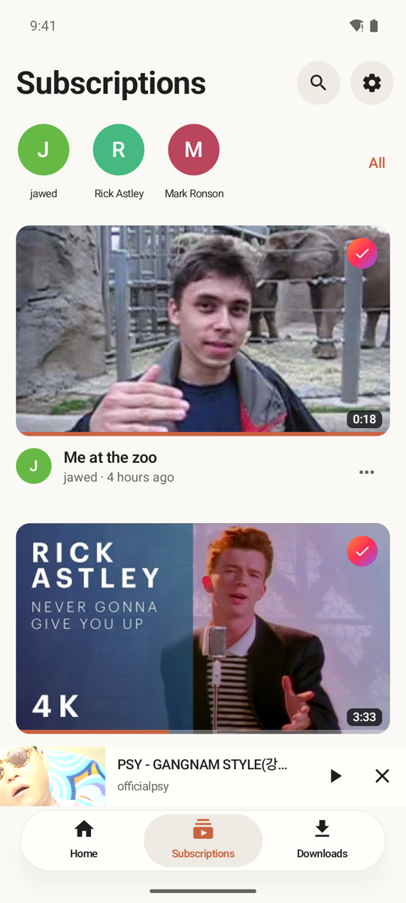
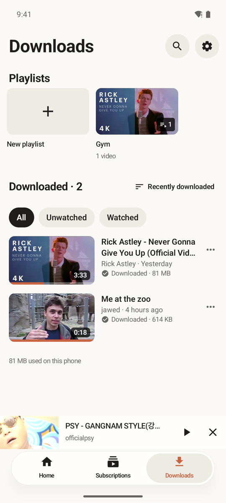
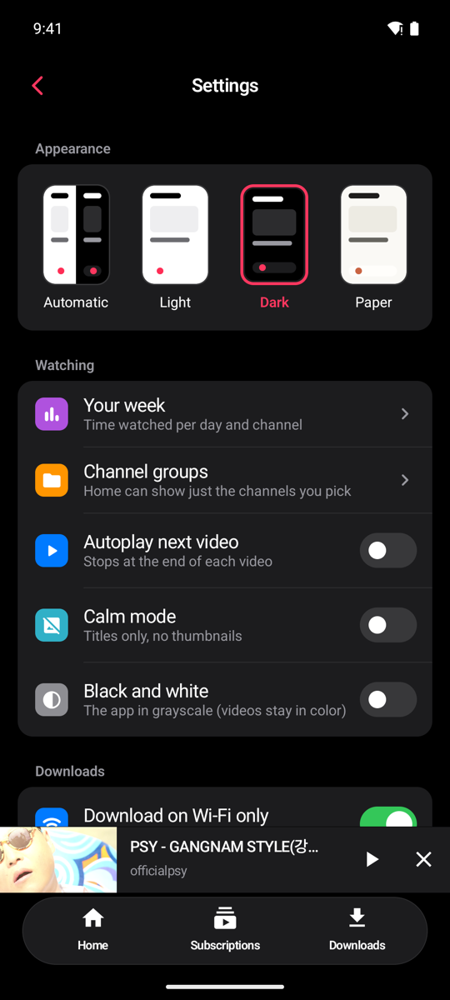
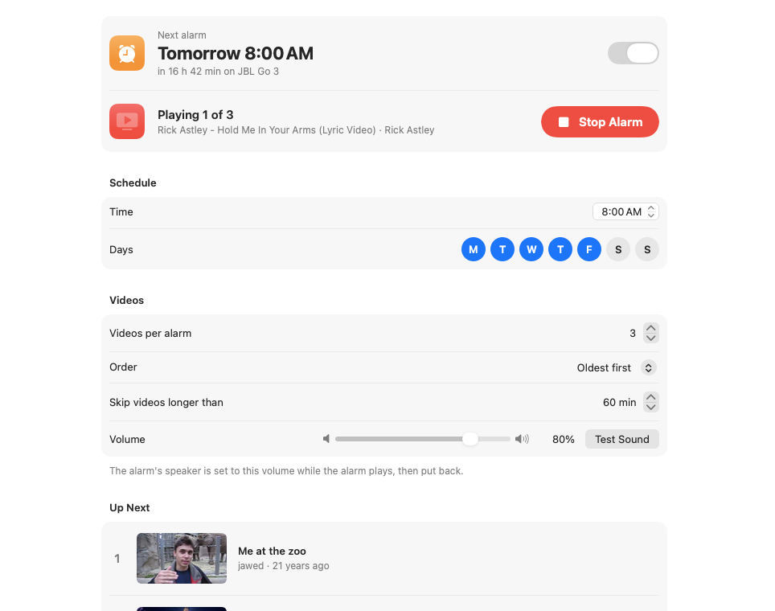
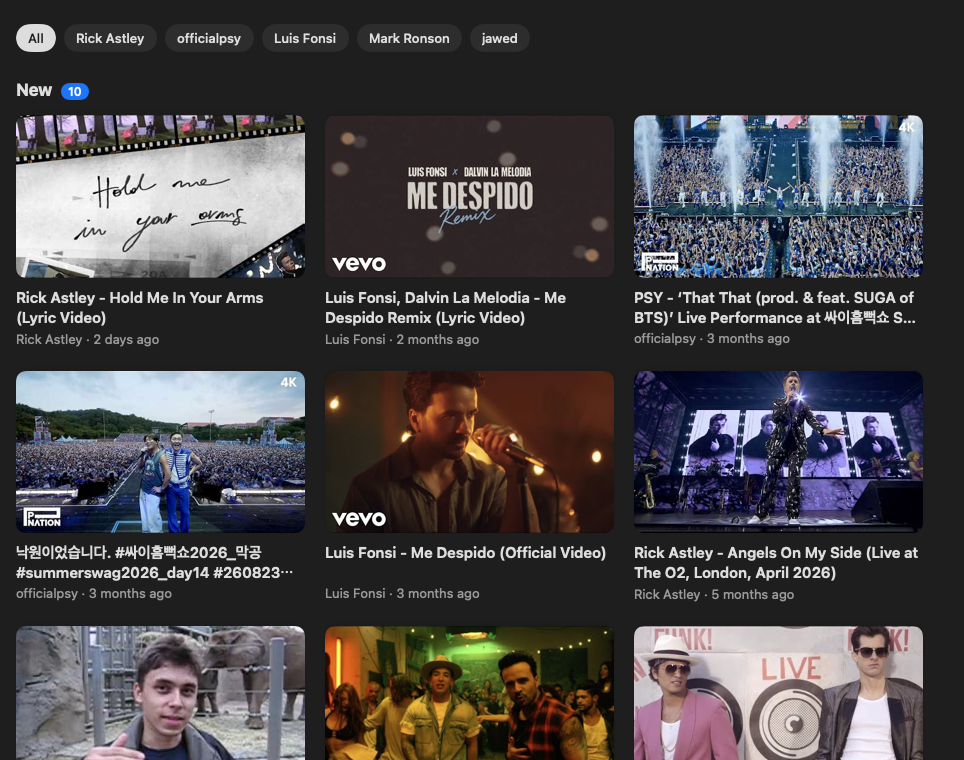

<p align="center">
  
</p>

<h1 align="center">Stow</h1>

<p align="center">
  A calmer YouTube: a Mac app that keeps an eye on the channels you follow and wakes you up with
  their new videos, and an Android app that plays and downloads what you pick, with no Shorts.
</p>

<p align="center">
  
  
  
  
</p>

<p align="center">
  
</p>

## What it does

**On the Mac**
- **Inbox:** new long-form uploads, members-only videos and past live broadcasts from the channels
  you follow, checked every 30 minutes. Everything else stays in Recent, one shelf per channel.
- **Watch in the app:** an mpv player beside the Inbox with YouTube-style controls, timeline
  previews, SponsorBlock skipping, and the video's comments underneath.
- **Morning alarm:** at the alarm time it plays the morning's new videos fullscreen on your speaker,
  and falls back to an older one or an alarm sound when there's nothing to play. The phone is its
  remote while it rings.
- **Members-only videos, done right:** it checks which ones your membership level can watch. Higher
  tiers and channels you aren't a member of stay hidden, and members-first videos that went public
  lose their badge.
- **Stores no videos.** Everything streams from YouTube.

**On the phone (Android)**
- **Home** with all of YouTube's recommendations, **Subscriptions** like YouTube's, and **channel
  groups** to see only the channels you pick.
- **Search all of YouTube**, with your recent searches; play or download any result.
- **No Shorts anywhere.** Live streams show only once they're over (labelled "Streamed").
- **Download** any video to watch offline (up to 1080p, or the quality you pick, up to 4K), in the background or on the lock screen. Long videos show
  their size first.
- **Upload dates** on every video ("3 days ago"), search results and channel pages included.
- **Player** with double-tap to skip, hold for 2×, comments, playback speed and autoplay.
- **Your week:** time watched per day and per channel. Optional calm mode (no thumbnails) and black and white.
- **Themes:** Automatic, Light, Dark and Paper, on both apps.

<p align="center">
  
  
  
</p>

<p align="center">
  
  
</p>

## How it works

```
 YouTube (RSS, yt-dlp, your signed-in session)
        │
        ▼
 Mac app ── checks channels, runs the alarm, streams with mpv
        │
        ▼  your own free Firebase project (Firestore + push)
        │
        ▼
 Android app ── shows the feeds, downloads with yt-dlp, plays offline
```

- The Mac does the checking: channel RSS feeds for uploads, yt-dlp for members-only videos, past
  broadcasts and your YouTube Home and Subscriptions feeds.
- It shares the results with the phone through a Firebase project you create yourself (free Spark
  plan). The phone pairs by scanning a QR code on the Mac. Your YouTube sign-in is sent encrypted with
  the pairing key and is only used for members-only videos.
- The phone downloads with its own copy of yt-dlp, so videos never pass through the Mac or Firebase.

**Or without the Mac.** On first launch the phone apps ask: *Use with my Mac* or *Use on its own*
(switch any time in Settings). On its own, the phone follows channels and checks them itself
(RSS, and yt-dlp for past streams), with no Firebase at all. Signing in to YouTube on the phone is
optional and adds Home, Subscriptions, members-only videos, importing your subscriptions and
watched sync. The alarm stays on the Mac. On iPhone, background checks run only when iOS allows,
so new videos show up when you open the app or when iOS gives it time.

## Getting started

**Mac** (macOS 26, Xcode 26)

```sh
brew install xcodegen yt-dlp mpv
cd mac
xcodegen generate
xcodebuild -project Stow.xcodeproj -scheme Stow -configuration Debug -derivedDataPath .build build
open .build/Build/Products/Debug/Stow.app
```

To sign with your own Apple ID, change `DEVELOPMENT_TEAM` and `CODE_SIGN_IDENTITY` in
[mac/project.yml](mac/project.yml) first.

Then sign in to YouTube under **Account** and add channels under **Channels**. After that the Mac
app updates itself: **Account › Updates** offers each new version from GitHub (published with
`mac/release.sh`), and it keeps its own copy of yt-dlp current every day. More in
[mac/README.md](mac/README.md) and [mac/ARCHITECTURE.md](mac/ARCHITECTURE.md).

**Firebase** (once, about 5 minutes): follow [firebase/SETUP.md](firebase/SETUP.md), then choose the
key file under **Phone** on the Mac.

**Android** (Android 12 or later): put your `google-services.json` in `android/app/`, then

```sh
cd android
./gradlew :app:assembleDebug
```

Release builds also need your own signing key in `android/keystore/`. Install the APK, then pair it from **Phone › Pair a Phone** on the Mac, or pick **Use on its own** (no Mac or Firebase needed; the build still wants a `google-services.json`, which can be a placeholder). More in
[android/README.md](android/README.md).

### Installing and updating the phone app with Obtainium

Stow isn't on Google Play: Play doesn't allow apps that download from YouTube. Instead,
`android/release.sh` builds the signed APK and publishes it as a
[GitHub release](https://github.com/kimdobinn/stow/releases), and
[Obtainium](https://github.com/ImranR98/Obtainium) on the phone installs it and updates it from
there.

1. Install Obtainium (from its GitHub releases or F-Droid).
2. In Obtainium, tap **Add App**, paste `https://github.com/kimdobinn/stow` (or your fork) and tap
   **Add**, then **Install**.
3. Obtainium checks for new releases in the background and offers each update.

Stow also checks by itself once a day: **Settings › About** shows **Update to …** with what's new, and
installs it after Android asks you to confirm.

To publish an update: bump `versionCode` and `versionName` in
[android/app/build.gradle.kts](android/app/build.gradle.kts), commit and push, then run
`android/release.sh`. Every release must be signed with the same key, or phones can't update over
the installed app.

The APKs here are built against my own Firebase project, so they only pair with my Mac. To use
Stow with yours, fork the repository, build with your `google-services.json` and signing key, and
point Obtainium at your fork.

**iPhone** (iOS 17 or later, new): a SwiftUI version of the phone app, with yt-dlp running on its
own copy of Python. Build it with

```sh
ios/scripts/fetch-python.sh
ios/scripts/firebase-config.sh      # from android/app/google-services.json
cd ios && xcodegen generate
```

then open `ios/Stow.xcodeproj`. More in [ios/README.md](ios/README.md). It differs from Android in
a few ways: there are no push notifications (they need a paid Apple developer account), so it checks
the Mac's list when you open it, every minute while it's open and when iOS lets it refresh in the
background; downloads stop a few minutes after you leave the app and continue when you come back;
downloads go up to 1080p; and the alarm remote isn't there yet.

### Installing and updating the iPhone app with SideStore

Apple doesn't allow YouTube downloaders in the App Store either. `ios/release.sh` publishes
`Stow-<version>.ipa` as a GitHub pre-release and lists it in [ios/source.json](ios/source.json), a
source that [SideStore](https://sidestore.io) and [AltStore](https://altstore.io) can follow.

1. Install SideStore on the iPhone (its website explains how; you need a computer once).
2. In SideStore, open **Sources**, tap **+** and add
   `https://raw.githubusercontent.com/kimdobinn/stow/main/ios/source.json`.
3. Install Stow from that source, then pair it from **Phone › Pair a Phone** on the Mac, the same
   way as the Android phone. Both phones can stay paired.

Stow checks GitHub once a day and shows when a new version is out; **Update in SideStore** opens
SideStore to install it. With a free Apple ID, apps installed this way stop opening after 7 days unless they're refreshed.
SideStore refreshes them on the phone; AltStore needs your computer on the same Wi-Fi.

## Notes

Stow is a personal project and isn't affiliated with YouTube or Google. It uses your own account and
your own Firebase project; nothing is sent anywhere else. The screenshots use public music videos as
demo data (`Stow --snapshot <dir> --demo` on the Mac, demo mode on the phone).
